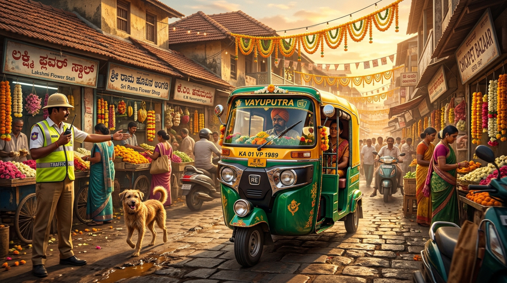
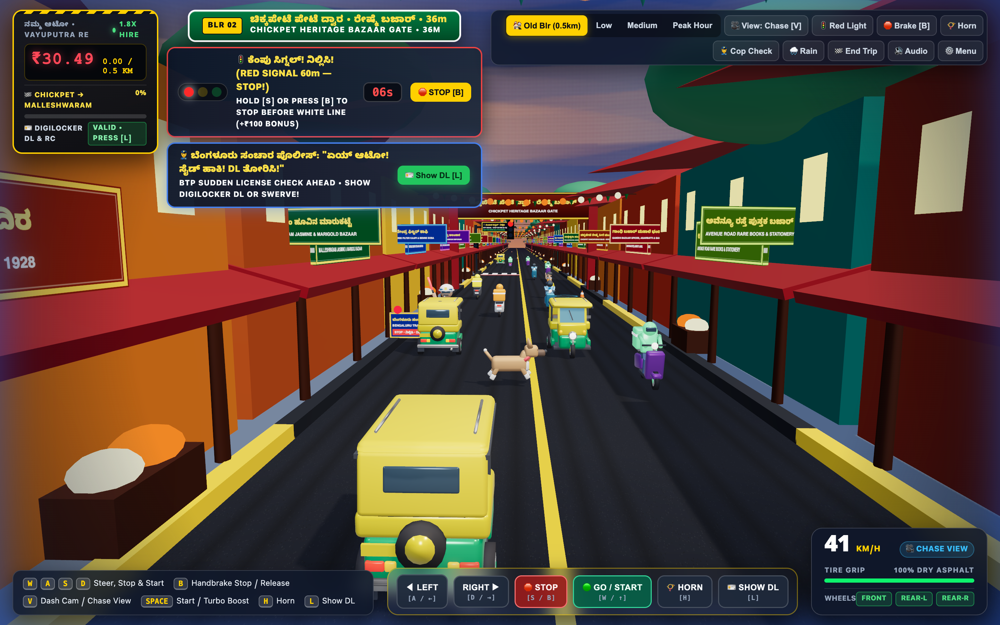
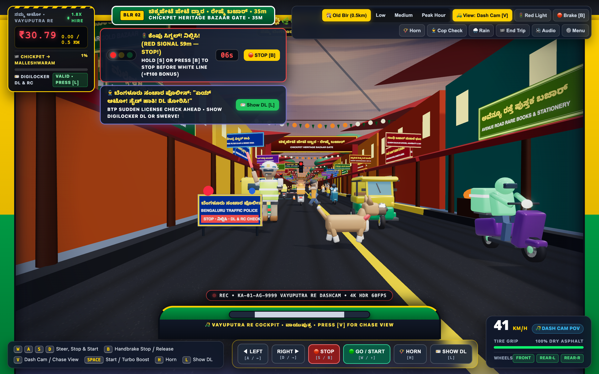

# 🛺 ಒಂದು ಸೆಕೆಂಡ್ | Ondu Second: Namma Auto Traffic (Ultra-HD Pro Edition)

<h3 align="center">
  🚀 Built End-to-End with <a href="https://antigravity.google/">Google Antigravity</a> &amp; <a href="https://deepmind.google/technologies/gemini/">Google Gemini Models</a> ✨
</h3>

<p align="center">
  <a href="https://antigravity.google/"></a>
  <a href="https://deepmind.google/technologies/gemini/"></a>
  <a href="https://www.blender.org/"></a>
  <a href="https://threejs.org/"></a>
  <a href="LICENSE"></a>
  <a href="agents.md"></a>
</p>

> [!IMPORTANT]
> **🤖 Created with [Google Antigravity](https://antigravity.google/) & [Google Gemini Models](https://deepmind.google/technologies/gemini/)**: Every layer of this game—its **12 procedural Blender 3D PBR `.glb` models** (authored via [Blender MCP](https://github.com/ahujasid/blender-mcp)), **Old Bengaluru narrow-gully heritage architecture**, **2K bilingual Kannada + English canvas textures**, **Three.js WebGL2 4x MSAA HDR engine**, **procedural Web Audio synthesizer**, and **2K HD key art**—was autonomously designed, engineered, and verified using **[Google Antigravity](https://antigravity.google/)**, Google's agentic AI coding platform powered by **[Google Gemini models](https://deepmind.google/technologies/gemini/)** ([Google AI for Developers](https://ai.google.dev/)). See **[`agents.md`](agents.md)** for full AI coding agent instructions, multi-agent roles, and Blender/Three.js conventions.

<p align="center">
  
</p>

<p align="center">
  <strong>A self-contained, Ultra-HD 3D WebGL2 (Three.js r170) arcade traffic game spanning both Old Bengaluru's narrow <code>0.5 KM</code> Chickpet → Malleshwaram flower-bazaar gullies and Bengaluru's bustling 6-lane Silk Board / Namma Metro highway corridor!</strong><br/>
  Drive the fictitious emerald-and-canary <strong>Vayuputra RE Compact (ವಾಯುಪುತ್ರ)</strong> Auto-Rickshaw with <strong>12 procedural PBR 3D <code>.glb</code> models</strong>, <strong>4x MSAA HalfFloat HDR graphics + 2K illustrated Kannada + English hoardings</strong>, <strong>interactive BTP Red-Light Signal Junctions (<code>0 KM/H</code> stop on Red, start on Green)</strong>, <strong>First-Person Auto Dash Cam &amp; 3rd-Person Chase views</strong>, <strong>100% grounded vehicle physics</strong>, <strong>forward-striding bazaar shoppers &amp; jaywalkers</strong>, sudden <strong>Bengaluru Traffic Police (BTP) license checks</strong>, darting <strong>Indie stray dogs</strong>, and a <strong>1-Click Shareable PNG Fare Receipt &amp; Scoreboard</strong>!
</p>

<p align="center">
  
</p>

---

## 🎬 Live 3D WebGL2 Retina HD (`2880×1800`) Gameplay Preview

### 🏘️ NEW! Old Bengaluru Narrow Gullies (`0.5 KM` Chickpet → Malleshwaram Heritage Sprint)

Squeeze your **Vayuputra RE** through a tight **`9.6m` 2-lane bazaar lane** flanked by 2-storey Mangalore clay-tile heritage shopfronts, overhanging wooden verandahs, marigold & jasmine flower vendor carts, festive overhead mango-leaf & marigold toranas, and bilingual Chickpet / Malleshwaram / Balepet / Avenue Road / Gandhi Bazaar shop signs!

| 🏘️ Old Bengaluru Gullies (`0.5 KM` Chase View) | 🛺 Old Bengaluru Gullies (Vayuputra RE Dash Cam POV) |
| :---: | :---: |
|  |  |

### 🚦 BTP Red-Light Traffic Signal Junctions & User-Configurable Camera Views (`[V]` Key)

| 🚦 BTP Red-Light Signal Junction (`0 KM/H` Stop & Start) | 🛺 Highway Dash Cam POV (4K HDR Cockpit View) |
| :---: | :---: |
|  |  |

### 🏁 4-Route Selector, Forward-Walking Pedestrians, Monsoon Storm & Viral Fare Receipt

| ⚙️ 4-Route Selector (`Old Blr 0.5 KM`, `1.2 KM`, `1.8 KM`, `2.5 KM`) | 🏃‍♂️ 2K Illustrated Hoardings, Forward-Striding Jaywalkers & Stray Dog |
| :---: | :---: |
|  |  |

| ⛈️ Silk Board 8 PM Peak Hour + Monsoon Hydroplaning (`0%` Grip) | 🏁 Final Trip Scoreboard, PNG Fare Receipt & Local Leaderboard |
| :---: | :---: |
|  |  |

### 🎨 Blender 5.2 QHD (`2560×1440`) Studio Showcase — All 12 Procedural PBR `.glb` Models


---

## ✨ Key Features in the Ultra-HD Pro Edition

### 1. 🏘️ Four Distinct Finite Bengaluru Journeys — Including Old Bengaluru Narrow Gullies (`0.5 KM`)
Choose from **4 handcrafted Bengaluru routes** in the Start Menu or switch instantly via the top-right toolbar:
1. **`🏘️ ಹಳೆಯ ಬೆಂಗಳೂರು ಗಲ್ಲಿ | Old Bengaluru Gullies` (`0.5 KM` • Chickpet → Malleshwaram)**:
   - Tight **`9.6m` 2-lane heritage bazaar street** (no wide highway buses—pure close-quarters weaving past oncoming autos, Swiggy/Zepto/Blinkit scooters, shoppers, stray dogs, and a beat cop!).
   - Surrounded by **Mangalore clay-tile heritage shopfronts**, wooden verandah pillars, marigold & jasmine flower baskets, overhead festival marigold toranas & fairy lights, and **Chickpet & Malleshwaram Heritage Bazaar Archways** (`1.8x` heritage meter rate!).
2. **`ಕಬ್ಬನ್ ಪಾರ್ಕ್ ಬೆಳಿಗ್ಗೆ | Cubbon Park Morning` (`1.2 KM` • MG Road → Cubbon Park)**: Cruising morning highway ride (`1.0x` rate).
3. **`ಇಂದಿರಾನಗರ ಸಂಜೆ ರಶ್ | Indiranagar 6 PM Rush` (`1.8 KM` • Silk Board → Indiranagar)**: Bustling evening rush with oncoming BMTC 500D buses, BTP signals, and sudden license checks (`1.5x` rate).
4. **`ಸಿಲ್ಕ್ ಬೋರ್ಡ್ ಟ್ರಾಫಿಕ್ | Silk Board 8 PM Gridlock` (`2.5 KM` • Electronic City → Hebbal)**: Dense peak-hour chaos with frequent monsoon downpours (`0%` tire friction hydroplaning) and `2.5x`–`3.8x` surge fares!

---

### 2. 💎 Ultra-HD 4x MSAA WebGL2 Graphics & 2K Illustrated Bilingual Signage
- **Hardware 4x MSAA HalfFloat HDR Pipeline**: Renders up to **`2.5x` Retina Device Pixel Ratio** into a multi-sampled `THREE.HalfFloatType` HDR render target with `4096×4096` PCF soft shadows, ACES Filmic tone mapping, and subtle bloom.
- **2K (`2048×1024`) Anisotropic Illustrated Hoardings**: Roadside billboards and Old Bengaluru bazaar shopboards feature crisp vector illustrations (steaming degree filter kaapi & masala dosa, auto-rickshaw medallions, KMF Nandini milk packs, Namma Metro trains, sandalwood seals, BTP shields) with trilinear mipmaps and maximum GPU anisotropy.
- **Micro-Grain `2048×2048` Bump-Mapped Asphalt & `2048×1024` Dusk Sky Dome**: High-frequency aggregate road surface relief and smooth golden-hour atmospheric gradients.

---

### 3. 🚦 Interactive BTP Red-Light Traffic Signal Junctions (Stop on Red, Start on Green!)
- **Stop at Red Light (`0 KM/H`)**: Hold **`S` / `↓`**, press **`B`** (Handbrake latch), or tap **`🛑 STOP [S / B]`** to bring your Vayuputra RE to a complete **`0 KM/H` stop** before the painted white stop line (`+₹100` & `+250 PTS` Lawful Stop Bonus!).
- **Start on Green**: When the signal turns **Green (`🟢 ಹಸಿರು ಸಿಗ್ನಲ್!`)**, press **`W` / `↑`**, **`SPACE`**, or tap **`🟢 GO / START`** to release the brake and accelerate cleanly.
- **Red-Light Camera Challan (`-₹150` & `-300 PTS`)**: Jumping a Red signal at speed triggers the BTP Red-Light Camera flash, siren burst, and automatic e-Challan fine!

---

### 4. 🎥 User-Configurable Camera Views (`[V]`): Vayuputra RE Dash Cam & 3rd-Person Chase
- **🛺 Vayuputra RE Dash Cam View (Driver Cockpit POV)**: Sit inside the **Vayuputra RE Compact (`ವಾಯುಪುತ್ರ`)** cockpit with canary-and-emerald A-pillars, tilting handlebar, hanging **Mysuru Mallige jasmine garland & nimbu-mirchi (`🍋🌶️`) charm**, animated monsoon wiper, and `🔴 REC • KA-01-AG-9999 VAYUPUTRA RE DASHCAM • 4K HDR 60FPS` OSD.
- **🎥 Regular Chase View (3rd-Person)**: Classic arcade chase camera showcasing your grounded 3-wheeled Vayuputra RE auto-rickshaw and bilingual rear hood plate.

---

### 5. 👮‍♂️ BTP License Checks, 🐕 Darting Indie Stray Dogs & 🏃‍♂️ Forward-Striding Pedestrians
- **Sudden BTP Whistle & License Stop (`traffic_police.glb`)**: Press **`L`** (or tap **`🪪 SHOW DL`**) to verify your DigiLocker DL & RC for **`+₹100` (`+300 PTS`)**, swerve around for **`+₹60`**, or risk a **`-₹100` e-Challan**!
- **Darting Indie Stray Dogs (`stray_dog.glb`)**: Honk (`H`) to make stray dogs bolt 2x faster or swerve around them for a **`+₹75` Good Boy Bonus**.
- **Forward-Aligned Pedestrians (`pedestrian_jaywalker.glb`)**: Bazaar shoppers and highway jaywalkers face cleanly forward along their exact crossing vector (`±X`) while raising the iconic Bengaluru *"Ondu Second!"* stop palm.

---

## 🎮 Controls (Keyboard + On-Screen Touch Bar)

| Key / HUD Button | Action |
| :--- | :--- |
| **`W` / `↑`** or **`🟢 GO / START`** | **Release Brake & Accelerate / Start from Red Light** |
| **`S` / `↓`** or **`🛑 STOP`** | **Brake to a Complete `0 KM/H` Stop (Hold before Red-Light Stop Line)** |
| **`B`** or **`🛑 Brake [B]`** | **Latch / Release Handbrake (`0 KM/H` Full Stop Toggle)** |
| **`A` / `D`** or **`◀ LEFT` / `RIGHT ▶`** | Steer Left / Right across highway lanes or narrow Old Bengaluru gullies |
| **`V`** or **`🎥 View: Chase [V]`** | **Toggle Camera View between Regular 3rd-Person Chase & Vayuputra RE Dash Cam POV** |
| **`G`** or **`🚦 Red Light`** | Trigger an immediate BTP Red-Light Signal Junction ahead |
| **`L`** or **`🪪 Show DL [L]`** | **Flash DigiLocker DL & RC to BTP Traffic Cop (`+₹100` Bonus!)** |
| **`C`** or **`👮 Cop Check`** | Trigger an immediate sudden BTP Traffic Police license check ahead |
| **`SPACE`** | Release brake & trigger grounded **⚡ Vayuputra Turbo Gap Boost** |
| **`H`** or **`📯 Horn`** | Blast the **Bengaluru Auto Horn (`"Pa-Pa-Paarp!"`)** — makes shoppers & stray dogs scurry |
| **`E`** or **`🏁 End Trip`** | Stop the meter early and open the **Final Trip Scoreboard & PNG Receipt Generator** |
| **`R`** | Reattach snapped Auto-Rickshaw wheels |
| **`T`** or **`🌧️ Rain`** | Toggle **Monsoon Downpour & Hydroplaning (`0%` Tire Grip + `1.5x` Surge Fare)** |
| **`ESC`** or **`⚙️ Menu`** | Open 4-Route, Difficulty & Camera Perspective Modal (`Old Blr 0.5km`, `Low`, `Medium`, `Peak Hour`) |

---

## 🚀 Quick Start & Testing

### Option 1: Open Directly (Zero-Install Single-File Bundle)
Because [`index.html`](index.html) embeds all **12 Blender `.glb` models** as gzip-compressed base64 fallbacks (`DecompressionStream('gzip')`), you can double-click `index.html` directly or run:
```bash
open index.html
```

### Option 2: Run Local HTTP Server
```bash
python3 -m http.server 8765
```
Then open **`http://localhost:8765/index.html`** in Chrome, Edge, Firefox, or Safari.

#### Optional URL Query Parameters for Instant Testing
- `http://localhost:8765/index.html?autostart=old_blr` — Launch directly into the **`0.5 KM` Old Bengaluru Narrow Gullies (`Chickpet → Malleshwaram`)** heritage sprint!
- `http://localhost:8765/index.html?autostart=old_blr&view=dashcam&copcheck=1` — Experience **Old Bengaluru Narrow Gullies** from inside the **Vayuputra RE Dash Cam cockpit**!
- `http://localhost:8765/index.html?autostart=medium&redlight=1` — Launch directly into a **BTP Red-Light Signal Junction** stopped at `0 KM/H` before the white stop line.
- `http://localhost:8765/index.html?autostart=old_blr&gameover=1` — Preview the **End-of-Trip Final Scoreboard, Thermal PNG Fare Receipt Generator & Local Leaderboard**.

---

## 🛠️ Rebuilding 3D Assets & HTML Bundle

1. **Regenerate all 12 PBR `.glb` models & `2560×1440` QHD studio showcase render in Blender**:
   ```bash
   /Applications/Blender.app/Contents/MacOS/Blender --background --python build_assets_blender.py
   ```
2. **Compile `index.html` from `build_game_html.py` and `assets/*.glb`**:
   ```bash
   python3 build_game_html.py
   ```

---

## 🤖 Built with Google Antigravity & Google Gemini Models

This project was created end-to-end using **[Google Antigravity](https://antigravity.google/)** and **[Google Gemini models](https://deepmind.google/technologies/gemini/)**:
- **[Google Antigravity (`antigravity.google`)](https://antigravity.google/)**: Agentic AI coding environment used to architect the Three.js WebGL2 4x MSAA simulation, automate Blender 3D asset generation, synthesize 2K bilingual Kannada + English highway & bazaar typography, and verify gameplay via Retina GPU browser renders.
- **[Google Gemini Models (`deepmind.google/technologies/gemini`)](https://deepmind.google/technologies/gemini/) & [Google AI for Developers (`ai.google.dev`)](https://ai.google.dev/)**: Multimodal reasoning, procedural 3D geometry scripting (`bpy`), Web Audio synthesis, and Ultra-HD key art generation.
- **[Blender MCP (`github.com/ahujasid/blender-mcp`)](https://github.com/ahujasid/blender-mcp)**: Model Context Protocol integration connecting Google Antigravity and Gemini models to Blender for live 3D `.glb` asset authoring.
- **[AI Coding Agent Guide (`agents.md`)](agents.md)**: Complete repository guide for AI coding agents covering multi-agent roles, cultural/physics guardrails, Blender-to-Three.js coordinate math, and Retina GPU screenshot verification.

---

## 📄 License

This project (code, procedural 3D `.glb` assets, and documentation) is open-source and released under the permissive **[MIT License](LICENSE)** — free to play, fork, remix, and use for personal or commercial projects with attribution.

