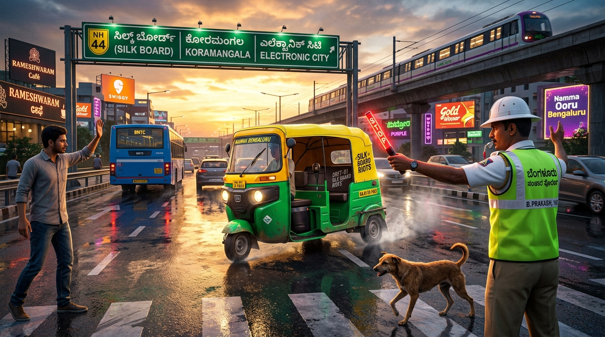
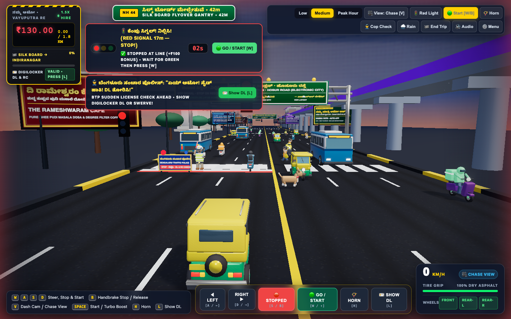
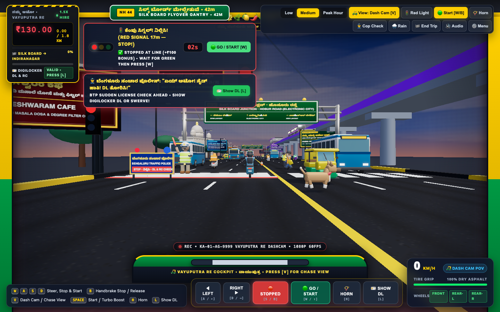
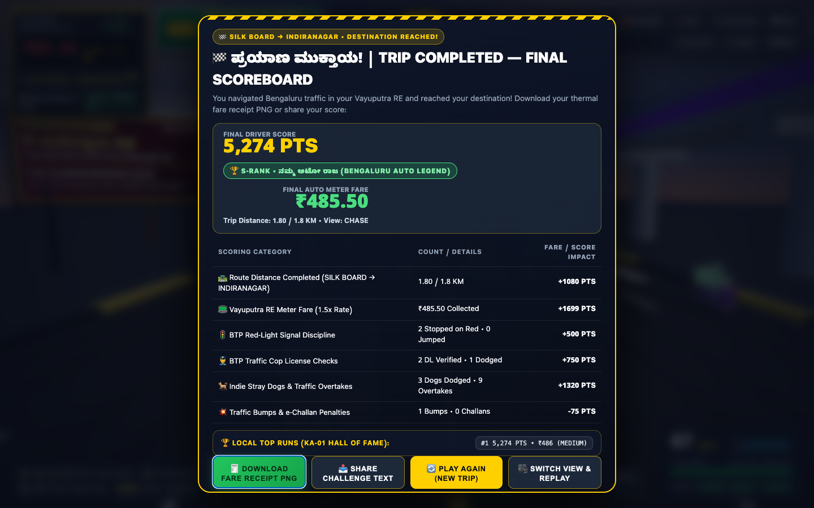
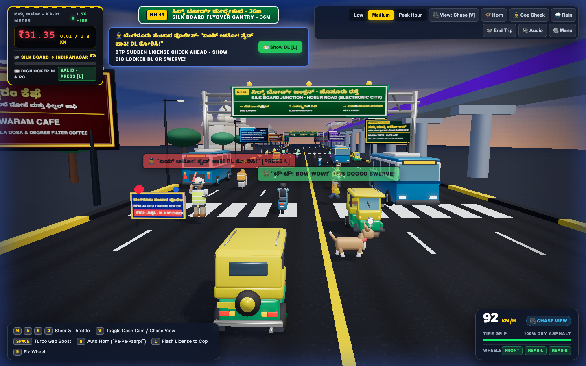
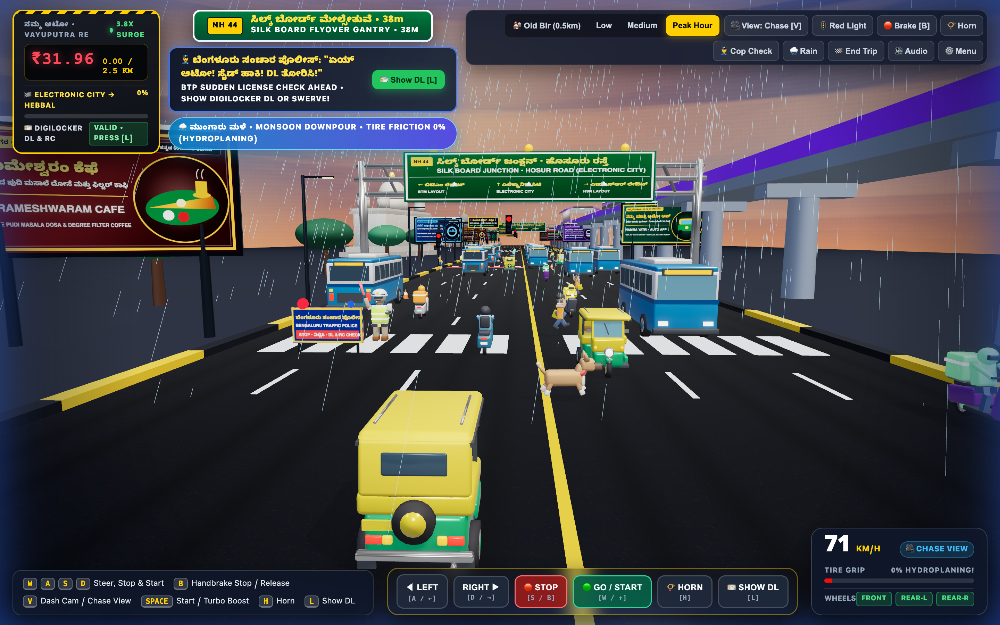
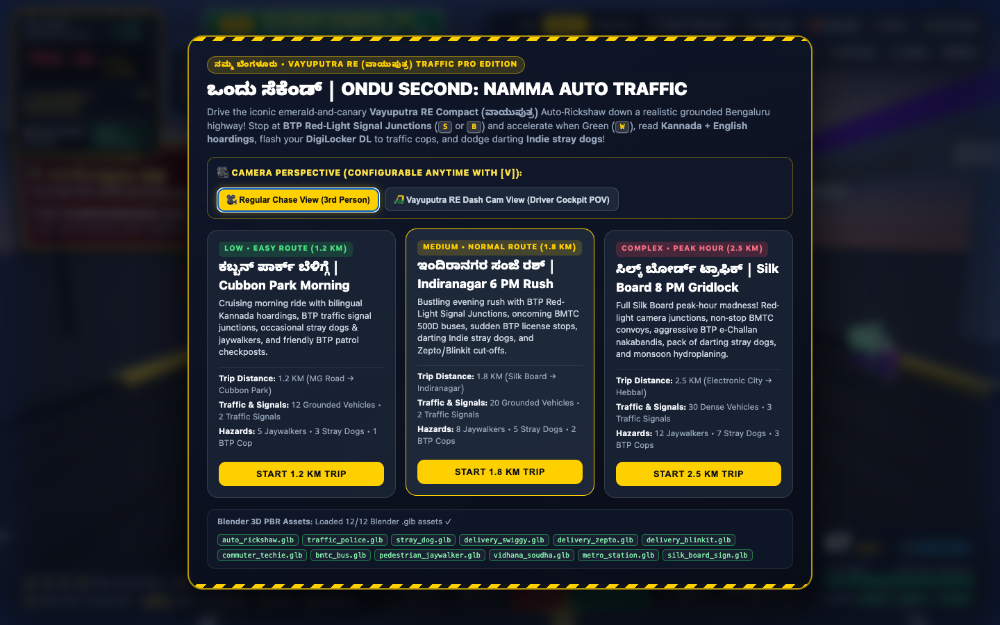
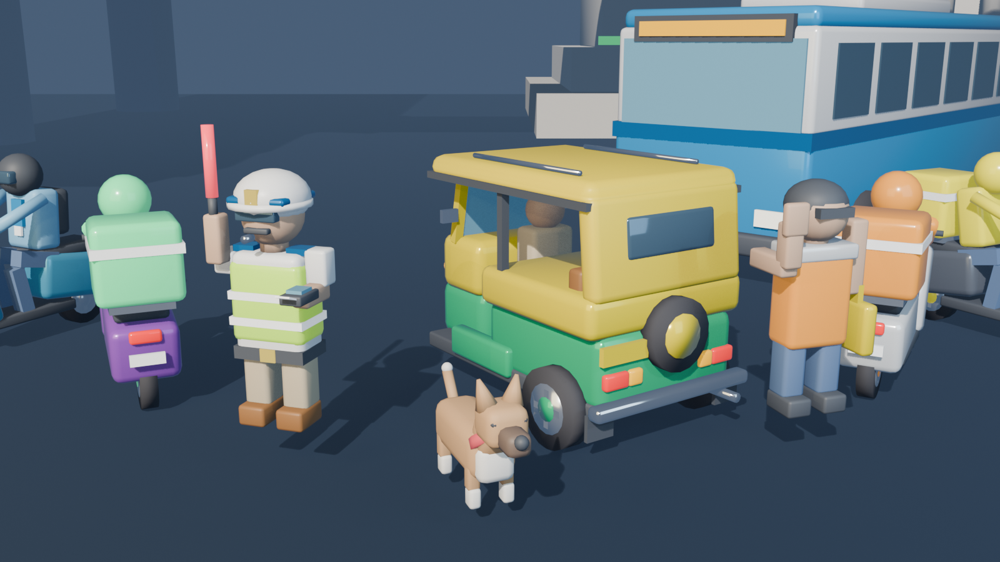

# 🛺 ಒಂದು ಸೆಕೆಂಡ್ | Ondu Second: Namma Auto Traffic (Pro Edition)

<p align="center">
  <a href="https://antigravity.google/"></a>
  <a href="https://deepmind.google/technologies/gemini/"></a>
  <a href="https://www.blender.org/"></a>
  <a href="https://threejs.org/"></a>
</p>

> **🤖 Created with Google Antigravity & Gemini Models**: This game—including its procedural Blender 3D PBR `.glb` asset pipeline, bilingual Kannada + English canvas texture synthesis, Three.js WebGL shader & post-processing architecture, Web Audio synthesizer, and AAA cover art—was autonomously designed, engineered, and verified using **[Google Antigravity](https://antigravity.google/)**, Google's agentic AI coding & development platform powered by **[Google Gemini models](https://deepmind.google/technologies/gemini/)** ([Gemini API / Google AI for Developers](https://ai.google.dev/)).

<p align="center">
  
</p>

<p align="center">
  <strong>A self-contained, pro-grade 3D WebGL (Three.js r170) arcade traffic game set on a bustling 6-lane Bengaluru highway corridor alongside the Namma Metro Purple Line viaduct, Vidhana Soudha, and the Silk Board flyover gantry.</strong><br/>
  Drive the fictitious emerald-and-canary <strong>Vayuputra RE Compact (ವಾಯುಪುತ್ರ)</strong> Auto-Rickshaw with <strong>12 procedural PBR 3D <code>.glb</code> models</strong>, <strong>interactive BTP Red-Light Signal Junctions (stop at 0 KM/H on Red, start on Green)</strong>, <strong>user-configurable First-Person Auto Dash Cam &amp; 3rd-Person Chase views</strong>, <strong>100% grounded vehicle physics</strong>, <strong>responsive Mobile/Tablet Touch Controls</strong>, <strong>Bilingual Kannada + English (60:40) hoardings</strong>, sudden <strong>Bengaluru Traffic Police (BTP) license checks</strong>, darting <strong>Indie stray dogs</strong>, and a <strong>1-Click Shareable PNG Fare Receipt &amp; Scoreboard</strong>!
</p>

---

## 🎬 Live 3D WebGL Gameplay Preview

### 🚦 BTP Red-Light Traffic Signal Junctions & User-Configurable Camera Views (`[V]` Key)

| 🚦 BTP Red-Light Signal Junction (`0 KM/H` Stop & Start) | 🛺 Vayuputra RE Dash Cam View (Driver Cockpit POV) |
| :---: | :---: |
|  |  |

### 🏁 Viral Fare Receipt Scoreboard, BTP Cop Checks & Monsoon Hydroplaning

| 🏁 Final Trip Scoreboard, PNG Fare Receipt & Local Leaderboard | 👮‍♂️ Sudden BTP Cop Check & Darting Stray Dog (100% Grounded) |
| :---: | :---: |
|  |  |

| ⛈️ Silk Board 8 PM Peak Hour + Monsoon Hydroplaning (`0%` Grip) | ⚙️ Route, Difficulty & Camera Perspective Selector (`<dialog>`) |
| :---: | :---: |
|  |  |

### 🎨 Blender 5.1 Studio Showcase — All 12 Procedural PBR `.glb` Models


---

## ✨ Key Features in the Pro Edition

### 1. 🚦 Interactive BTP Red-Light Traffic Signal Junctions (Stop on Red, Start on Green!)
- **3D Cantilever Signal Gantry & Painted Stop Lines**: Authentic Bengaluru Traffic Police signal junctions span the forward lanes with dual Red/Yellow/Green LED signal heads, a bilingual `🚦 ಸಂಚಾರ ಸಿಗ್ನಲ್ • ನಿಲ್ಲಿಸಿ / BTP SIGNAL • STOP ON RED [S / B]` signboard, zebra crossings, and a thick white stop line.
- **Full `0 KM/H` Stop & Start Controls**:
  - **Stop at Red Light**: Hold **`S` / `↓`**, press **`B`** (Handbrake latch), or tap the on-screen **`🛑 STOP [S / B]`** button to bring your Vayuputra RE Auto to a complete **`0 KM/H` stop** before the white line. Same-direction NPC vehicles also queue behind active Red lights!
  - **Lawful Stop Bonus (`+₹100` & `+250 PTS`)**: Stopping cleanly before the line on Red awards a **`+₹100` Law-Abiding Driver Bonus** and fast-forwards the signal countdown so you only wait a moment for Green.
  - **Start on Green**: When the signal turns **Green (`🟢 ಹಸಿರು ಸಿಗ್ನಲ್!`)**, press **`W` / `↑`**, **`SPACE`**, or tap **`🟢 GO / START`** to release the brake and accelerate back to cruising speed.
  - **Red-Light Camera Challan (`-₹150` & `-300 PTS`)**: Jumping a Red signal at speed triggers the BTP Red-Light Camera flash, police siren burst, and an automatic `-₹150` e-Challan deduction!

---

### 2. 🎥 User-Configurable Camera Views: Vayuputra RE Dash Cam & 3rd-Person Chase (`[V]`)
Switch perspectives anytime during gameplay by pressing **`V`**, clicking **`🎥 View: Chase [V]` / `🛺 View: Dash Cam [V]`** in the top-right toolbar, or choosing your preferred perspective in the Start Menu:
- **🛺 Vayuputra RE Dash Cam View (Driver Cockpit POV)**: Places the camera directly inside the **Vayuputra RE Compact (`ವಾಯುಪುತ್ರ`)** Auto-Rickshaw driver's cockpit looking out through the front windshield. Complete with canary-yellow and emerald-green cabin A-pillars, a steering handlebar that tilts as you steer, a hanging **Mysuru Mallige jasmine garland & nimbu-mirchi (`🍋🌶️`) charm**, an animated windshield wiper that sweeps during monsoon downpours, and a live `🔴 REC • KA-01-AG-9999 VAYUPUTRA RE DASHCAM • 1080P 60FPS` OSD.
- **🎥 Regular Chase View (3rd-Person)**: Classic arcade chase camera showcasing your emerald-and-canary Vayuputra RE Auto-Rickshaw, its bilingual `ನಮ್ಮ ಬೆಂಗಳೂರು • ಒಂದು ಸೆಕೆಂಡ್ / NAMMA BENGALURU • KA-01-AG-9999` rear canopy plate, and all 3 rotating wheels.

---

### 3. 🧾 Viral Shareable PNG Fare Receipt, Local Leaderboard & Mobile Touch Controls
- **1-Click Shareable "Namma Auto Fare Receipt & Driver Score Card" PNG**: At the end of every trip, click **`🧾 Download Fare Receipt PNG`** to generate and download a crisp `800×980` canary-yellow-and-charcoal thermal receipt image showing your Route, Final Meter Fare (`₹`), Driver Score (`PTS`), Rank Badge (`S-RANK • ನಮ್ಮ ಆಟೋ ರಾಜ`), and itemized breakdown—ready to post on WhatsApp, X/Twitter, Reddit (`r/bangalore`), or LinkedIn!
- **1-Click Challenge Text (`📤 Share Challenge Text`)**: Uses the native Web Share API (on mobile) or copies a formatted challenge blurb to your clipboard.
- **Persistent Local High-Score Leaderboard (`KA-01 Hall of Fame`)**: Automatically saves your top 5 runs in `localStorage` and displays them on the Scoreboard.
- **Responsive On-Screen Touch & Mouse Control Deck**: Play effortlessly on phones, tablets, or desktop mice with the bottom-center control bar (`◀ LEFT`, `RIGHT ▶`, `🛑 STOP`, `🟢 GO / START`, `📯 HORN`, `🪪 SHOW DL`).

---

### 4. 🪧 Authentic Bilingual Kannada + English Hoardings & Highway Gantries (60:40 Rule)
Every roadside billboard, overhead National Highway gantry, BTP police barricade, rear auto canopy stencil, and HUD banner features authentic **Kannada (`ಕನ್ನಡ`) + English** typography following Bengaluru's iconic **60% Kannada : 40% English** commercial signage standard:

| Hoarding / Signage | Primary Kannada (`ಕನ್ನಡ 60%`) | Secondary English (`40%`) |
| :--- | :--- | :--- |
| **The Rameshwaram Cafe** | `ದಿ ರಾಮೇಶ್ವರಂ ಕೆಫೆ • ಶುದ್ಧ ತುಪ್ಪದ ಪುದಿ ಮಸಾಲೆ ದೋಸೆ ಮತ್ತು ಫಿಲ್ಟರ್ ಕಾಫಿ` | `THE RAMESHWARAM CAFE • PURE GHEE PUDI MASALA DOSA & DEGREE FILTER COFFEE` |
| **Namma Yatri Auto App** | `ನಮ್ಮ ಯಾತ್ರಿ ಆಟೋ ಆಪ್ • ಆಟೋ ಚಾಲಕರ ಸ್ವಂತ ಆಪ್ • ಮೀಟರ್ ಮೇಲೆ ₹೨೦ ಬೇಡ!` | `NAMMA YATRI • AUTO APP • 100% DIRECT TO DRIVER • ZERO COMMISSION` |
| **KMF Nandini Dairy** | `ನಂದಿನಿ ತಾಜಾ ಹಾಲು ಮತ್ತು ಸಿಹಿ • ಪ್ರತಿ ದಿನ ಬೆಳಿಗ್ಗೆ ಪರಿಶುದ್ಧ ಹಾಲು, ಮೊಸರು ಮತ್ತು ತುಪ್ಪ` | `KMF NANDINI MILK & MYSORE PAK • GOOD LIFE PURE MILK, CURD & GHEE SWEETS` |
| **Namma Metro Purple Line** | `ನಮ್ಮ ಮೆಟ್ರೋ - ನೇರಳೆ ಮಾರ್ಗ • ವೈಟ್‌ಫೀಲ್ಡ್ ನಿಂದ ಚಲ್ಲಘಟ್ಟ ವರೆಗೆ ಟ್ರಾಫಿಕ್ ಇಲ್ಲದ ಪ್ರಯಾಣ!` | `NAMMA METRO PURPLE LINE • WHITEFIELD TO CHALLAGHATTA • BEAT SILK BOARD RUSH` |
| **Mysore Sandal Soap** | `ಮೈಸೂರು ಸ್ಯಾಂಡಲ್ ಸೋಪ್ • ಶೇಕಡಾ ೧೦೦ ಪರಿಶುದ್ಧ ಶ್ರೀಗಂಧದ ಎಣ್ಣೆಯ ಸೋಪು` | `MYSORE SANDAL SOAP • 100% PURE NATURAL SANDALWOOD OIL • SINCE 1916` |
| **Bengaluru Traffic Police** | `ಸಂಚಾರ ನಿಯಮ ಪಾಲಿಸಿ • ಸುರಕ್ಷಿತವಾಗಿರಿ • ಮುಂದೆ ತಪಾಸಣೆ ಇದೆ • DL, RC ತೋರಿಸಿ!` | `BENGALURU TRAFFIC POLICE ALERT • SUDDEN LICENSE & E-CHALLAN CHECK AHEAD` |
| **Zepto & Blinkit Super Store** | `ಜೆಪ್ಟೊ ಮತ್ತು ಬ್ಲಿಂಕಿಟ್ ಸೂಪರ್ ಸ್ಟೋರ್ • ಕೊತ್ತಂಬರಿ ಸೊಪ್ಪು, ಹಾಲು ೧೦ ನಿಮಿಷದಲ್ಲಿ!` | `ZEPTO & BLINKIT DARK STORE • FRESH CORIANDER, MILK & SNACKS IN 10 MINUTES` |
| **Vidyarthi Bhavan** | `ವಿದ್ಯಾರ್ಥಿ ಭವನ ಮಸಾಲೆ ದೋಸೆ • ಬೆಂಗಳೂರಿನ ಇತಿಹಾಸ ಪ್ರಸಿದ್ಧ ಗರಿಗರಿ ಬೆಣ್ಣೆ ಮಸಾಲೆ ದೋಸೆ` | `VIDYARTHI BHAVAN HERITAGE • LEGENDARY CRISPY BUTTER MASALA DOSA (SINCE 1943)` |
| **NH-44 Overhead Gantries** | `ಸಿಲ್ಕ್ ಬೋರ್ಡ್ ಜಂಕ್ಷನ್ • ಹೊಸೂರು ರಸ್ತೆ` & `ಹೆಬ್ಬಾಳ ಮೇಲ್ಸೇತುವೆ • ಹೊರ ವರ್ತುಲ ರಸ್ತೆ (ORR)` | `SILK BOARD JUNCTION (ELECTRONIC CITY)` & `HEBBAL FLYOVER (KIAL AIRPORT)` |

---

### 5. 👮‍♂️ Sudden Bengaluru Traffic Police (BTP) License Check (`traffic_police.glb`) & 🐕 Darting Stray Dogs (`stray_dog.glb`)
- **Sudden BTP Whistle & License Stop**: BTP officers in white pith helmets and lime-green reflective vests blow a shrill pea-whistle (`"PRRREEEET!"`) and step into your lane waving a glowing red LED baton:
  - Press **`L`** (or click **`🪪 Show DL [L]`**) to flash your DigiLocker DL & RC for a **`+₹100` (`+300 PTS`) bonus**, swerve around for **`+₹60` (`+150 PTS`)**, or risk a **`-₹100` (`-250 PTS`) e-Challan fine**!
- **Sudden Darting Indie Stray Dogs**: Authentic terracotta Indian Pariah dogs (`stray_dog.glb`) bolt across the highway with a synthesized double-bark (`"ಬೌ-ಬೌ! BOW-WOW!"`). Honk (`H`) to make them sprint 2x faster or swerve cleanly around them for a **`+₹75` (`+200 PTS`) Good Boy Bonus**!

---

## 🎮 Controls (Keyboard + On-Screen Touch Bar)

| Key / HUD Button | Action |
| :--- | :--- |
| **`W` / `↑`** or **`🟢 GO / START`** | **Release Brake & Accelerate / Start from Red Light** |
| **`S` / `↓`** or **`🛑 STOP`** | **Brake to a Complete `0 KM/H` Stop (Hold before Red-Light Stop Line)** |
| **`B`** or **`🛑 Brake [B]`** | **Latch / Release Handbrake (`0 KM/H` Full Stop Toggle)** |
| **`A` / `D`** or **`◀ LEFT` / `RIGHT ▶`** | Steer Left / Right across the 6 lanes |
| **`V`** or **`🎥 View: Chase [V]`** | **Toggle Camera View between Regular 3rd-Person Chase & Vayuputra RE Dash Cam POV** |
| **`G`** or **`🚦 Red Light`** | Trigger an immediate BTP Red-Light Signal Junction ahead |
| **`L`** or **`🪪 Show DL [L]`** | **Flash DigiLocker DL & RC to BTP Traffic Cop (`+₹100` Bonus!)** |
| **`C`** or **`👮 Cop Check`** | Trigger an immediate sudden BTP Traffic Police license check ahead |
| **`SPACE`** | Release brake & trigger grounded **⚡ Vayuputra Turbo Gap Boost** |
| **`H`** or **`📯 Horn`** | Blast the **Bengaluru Auto Horn (`"Pa-Pa-Paarp!"`)** — makes jaywalkers & stray dogs scurry |
| **`E`** or **`🏁 End Trip`** | Stop the meter early and open the **Final Trip Scoreboard & Receipt Generator** |
| **`R`** | Reattach snapped Auto-Rickshaw wheels |
| **`T`** or **`🌧️ Rain`** | Toggle **Monsoon Downpour & Hydroplaning (`0%` Tire Grip + `1.5x` Surge Fare)** |
| **`ESC`** or **`⚙️ Menu`** | Open Route, Difficulty & Camera Perspective Modal (`Low`, `Medium`, `Peak Hour`) |

---

## 🚀 Quick Start & Testing

### Option 1: Open Directly (Zero-Install Single-File Bundle)
Because [`index.html`](index.html) embeds all **12 Blender `.glb` models** as gzip-compressed base64 fallbacks (`DecompressionStream('gzip')`), you can double-click `index.html` directly in Finder/Explorer or run:
```bash
open index.html
```

### Option 2: Run Local HTTP Server
```bash
python3 -m http.server 8765
```
Then open **`http://localhost:8765/index.html`** in Chrome, Edge, Firefox, or Safari.

#### Optional URL Query Parameters for Instant Testing
- `http://localhost:8765/index.html?autostart=medium&redlight=1` — Launch directly into a **BTP Red-Light Signal Junction** with your Vayuputra RE stopped at `0 KM/H` before the white stop line.
- `http://localhost:8765/index.html?autostart=medium&view=dashcam&copcheck=1` — Launch directly into **First-Person Vayuputra RE Dash Cam POV** with an active BTP Traffic Cop checkpost ahead.
- `http://localhost:8765/index.html?autostart=medium&gameover=1` — Preview the **End-of-Trip Final Scoreboard, PNG Fare Receipt Generator & Local Leaderboard**.
- `http://localhost:8765/index.html?autostart=complex&rain=1&snapwheel=1&copcheck=1` — Launch directly into **Peak Hour (`ಸಿಲ್ಕ್ ಬೋರ್ಡ್ ಟ್ರಾಫಿಕ್ | Silk Board 8 PM Gridlock`)** with monsoon downpour, hydroplaning, and BTP nakabandi.

---

## 🛠️ Rebuilding 3D Assets & HTML Bundle

1. **Regenerate all 12 PBR `.glb` models & studio showcase render in Blender**:
   ```bash
   /Applications/Blender.app/Contents/MacOS/Blender --background --python build_assets_blender.py
   ```
   *(Or run `python3 build_assets_blender.py` to execute via a running Blender MCP socket on `127.0.0.1:9876` — see [`agents.md`](agents.md) for details.)*

2. **Compile `index.html` from `build_game_html.py` and `assets/*.glb`**:
   ```bash
   python3 build_game_html.py
   ```

---

## 🤖 Built with Google Antigravity & Google Gemini Models

This project was created end-to-end using **[Google Antigravity](https://antigravity.google/)** and **[Google Gemini models](https://deepmind.google/technologies/gemini/)**:
- **[Google Antigravity (`antigravity.google`)](https://antigravity.google/)**: Agentic AI coding environment used to architect the Three.js WebGL simulation, automate Blender 3D asset generation via MCP, synthesize bilingual Kannada + English highway typography, and verify gameplay via headless browser inspection.
- **[Google Gemini Models (`deepmind.google/technologies/gemini`)](https://deepmind.google/technologies/gemini/) & [Google AI for Developers (`ai.google.dev`)](https://ai.google.dev/)**: Multimodal reasoning, procedural 3D geometry scripting (`bpy`), Web Audio synthesis, and generative visual asset creation.
- **[Blender MCP (`github.com/ahujasid/blender-mcp`)](https://github.com/ahujasid/blender-mcp)**: Model Context Protocol integration connecting Google Antigravity and Gemini models to Blender 5.1 for live 3D `.glb` asset authoring.
