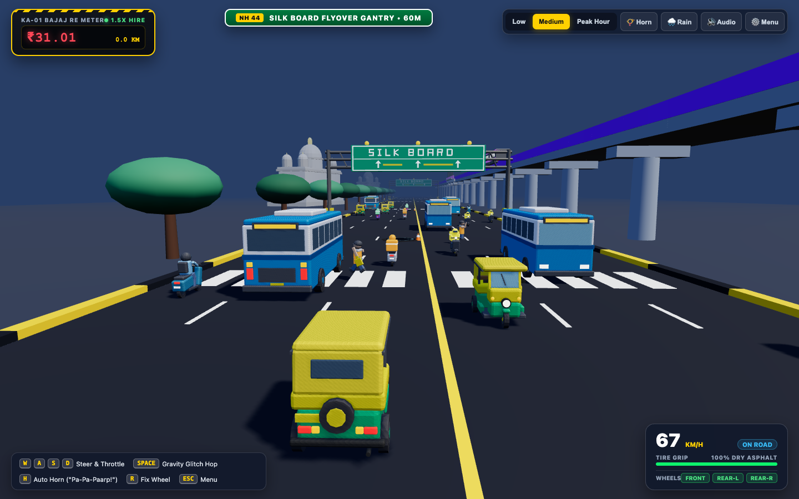

# 🛺 Ondu Second: Bangalore Gravity Glitch

A self-contained **3D WebGL (Three.js)** arcade traffic game set on a bustling 6-lane Bengaluru highway corridor alongside the continuous **Namma Metro Purple Line** elevated viaduct, **Vidhana Soudha**, and the **Silk Board** flyover gantry. All 10 low-poly 3D `.glb` models were procedurally modeled and exported via a local **Blender MCP** server.



---

## ✨ Features

- **Authentic Bengaluru Bajaj RE Auto-Rickshaw**:
  - Canary-yellow soft-top canopy (`#FFD000`) with rear window and spare wheel, plus an emerald-green lower chassis (`#009A44`).
  - **3 Detachable Axle-Centered Wheels** (`Wheel_Front`, `Wheel_Rear_L`, `Wheel_Rear_R`) that spin independently, snap off on heavy collisions, tilt the chassis, and can be repaired on the fly (`R`).
- **Two-Way Indian Traffic**:
  - **Left-Hand Lanes (`x < 0`)**: Drive **forward** (`-Z`) alongside BMTC 500D buses, fellow autos, IT techies on scooters, and hyper-speed **Zepto** (neon green), **Blinkit** (bright yellow), and **Swiggy** (bright orange) delivery riders.
  - **Right-Hand Lanes (`x > 0`)**: **Oncoming traffic** (`+Z`) with glowing headlights and front windshields approaching head-on when you cross the double-yellow median to overtake.
- **Sudden Road-Crossing Jaywalkers (`pedestrian_jaywalker.glb`)**:
  - Pedestrians wait along the kerbs and zebra crossings and **suddenly dart across the road** as you approach, raising the iconic Bengaluru ***"Ondu Second!"* (Stop Hand)** palm gesture while carrying a cloth `jhola` shopping bag.
  - Honking (`H`) makes jaywalkers wave and scurry faster out of your lane!
- **Dynamic Hazards & Controlled Gravity Glitch**:
  - **Magnetic BBMP Potholes**: Cracked asphalt craters with rainwater puddles and traffic cones that pull nearby vehicles laterally and launch them into a controlled low-G bounce arc (`SPACE` to hop over potholes).
  - **Monsoon Downpours**: Sudden tropical storms trigger a 1,600-streak 3D rain particle system, wet road reflections, **`0%` tire grip (hydroplaning drift)**, and **`1.5x` surge fare**.
- **Zero-Dependency Web Audio API Synthesizer**:
  - Continuous background city drone + speed-modulated 2-stroke auto *"tuk-tuk"* engine.
  - **Multi-Harmonic Bengaluru Auto-Rickshaw Horn (`"PA-PA-PAAARP!"`)**: Dual discordant brass reeds (`442 Hz` + `554 Hz`), rubber-bulb air-cavity thump, `52 Hz` mechanical diaphragm rattle modulation, nonlinear waveshaper saturation, and under-flyover street slapback echo.
  - Pink-noise torrential monsoon rain layer.

---

## 📸 Screenshots

| Gravity Profiles Menu (`<dialog>`) | Peak Hour Mode + Monsoon Downpour (`0%` Grip) |
| :---: | :---: |
|  |  |

| Blender 5.2 LTS 3D Vehicle Assets | Responsive 4-Corner Arcade HUD |
| :---: | :---: |
|  |  |

---

## 🎮 Controls

| Key / Button | Action |
| :--- | :--- |
| **`W` / `↑`** | Accelerate / Throttle |
| **`S` / `↓`** | Brake / Slow Down |
| **`A` / `D`** or **`←` / `→`** | Steer Left / Right across the 6 lanes |
| **`SPACE`** | Trigger Zero-G **Gravity Glitch Hop** (jump over potholes!) |
| **`H`** or **`📯 Horn`** | Blast the **Bengaluru Auto Horn (`"Pa-Pa-Paarp!"`)** |
| **`R`** | Reattach snapped Auto-Rickshaw wheels |
| **`T`** or **`🌧️ Rain`** | Toggle Monsoon Downpour & Hydroplaning (`0%` Tire Grip) |
| **`ESC`** or **`⚙️ Menu`** | Open Difficulty / Gravity Profiles Modal |

---

## 🚀 Quick Start

### Option 1: Open Directly
Because [`index.html`](index.html) embeds all 10 Blender `.glb` models as gzip-compressed base64 fallbacks (`DecompressionStream('gzip')`), you can open `index.html` directly in any modern browser.

### Option 2: Run Local HTTP Server
```bash
python3 -m http.server 8765
```
Then open **`http://localhost:8765/index.html`** in Chrome, Edge, Firefox, or Safari.

#### Optional URL Query Parameters
- `http://localhost:8765/index.html?autostart=low` — Launch directly into **Low (Cubbon Park Morning)** mode.
- `http://localhost:8765/index.html?autostart=medium` — Launch directly into **Medium (Indiranagar 6 PM Rush)** mode.
- `http://localhost:8765/index.html?autostart=complex&rain=1&snapwheel=1` — Launch directly into **Complex (Silk Board 8 PM Gridlock)** mode with monsoon rain active.

---

## 🛠️ Rebuilding 3D Assets & HTML Bundle

1. **Regenerate all 10 `.glb` models in Blender via Blender MCP (`127.0.0.1:9876`)**:
   ```bash
   python3 build_assets_blender.py
   ```
   *(Or send `build_assets_blender.py` to the running Blender MCP socket — see [`agents.md`](agents.md) for details.)*

2. **Compile `index.html` from `build_game_html.py` and `assets/*.glb`**:
   ```bash
   python3 build_game_html.py
   ```

---

## 📦 Included Blender `.glb` 3D Assets (`assets/`)

| Asset File | Description |
| :--- | :--- |
| `auto_rickshaw.glb` | Canary-yellow & emerald-green Bengaluru Bajaj RE auto with 3 detachable wheels |
| `bmtc_bus.glb` | BMTC 500D Silk Board bus with front/rear LED destination boards & 4 detachable wheels |
| `delivery_swiggy.glb` | Swiggy rider (`#FC8019` bright orange jacket & thermal box on white scooter) |
| `delivery_zepto.glb` | Zepto hyper-delivery rider (`#10F560` neon green jacket & cargo box on purple scooter) |
| `delivery_blinkit.glb` | Blinkit hyper-delivery rider (`#FFE600` bright yellow jacket & cargo box on charcoal scooter) |
| `commuter_techie.glb` | Bengaluru IT commuter with sky-blue shirt, ID lanyard badge & laptop backpack |
| `pedestrian_jaywalker.glb` | Articulated jaywalker pedestrian with `jhola` bag and raised *"Ondu Second!"* stop hand |
| `vidhana_soudha.glb` | Neo-Dravidian granite facade with colonnade, central dome & tricolor lights |
| `metro_station.glb` | Namma Metro Purple Line station + continuous `Metro_Train` |
| `silk_board_sign.glb` | Double-sided overhead National Highway green gantry sign (`SILK BOARD`) |
